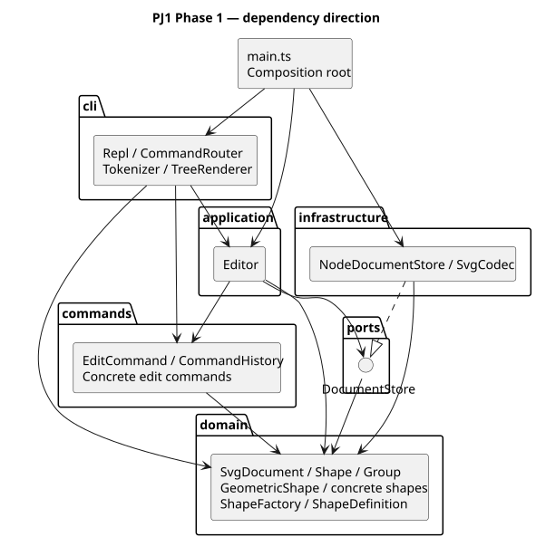
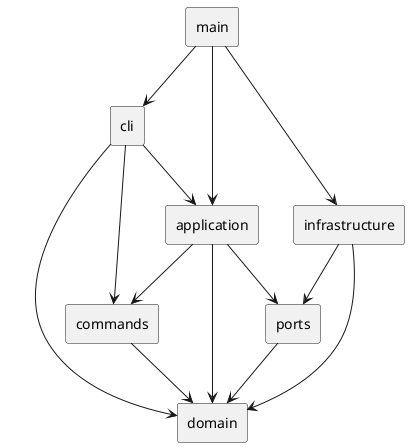

# PJ1 Phase 1：CLI SVG 编辑器

作者：赵乐恒（24301010014）。本项目使用 TypeScript 与 Codex 协作实现，需求基准为工程根目录的 [phase_cli_1.md](../phase_cli_1.md)。开发和本地验收日期：2026-10-21（Asia/Shanghai）。

## 运行与提交

需要 Node.js ≥22，推荐 24；依赖版本由 `package-lock.json` 锁定。

```sh
npm ci
npm run cli
```

交互提示符为 `svg>`，输入 `help` 查看命令，`quit`/`exit` 或 EOF 退出。Windows 当前机器已准备 Node.js；新终端可使用 npm，也可执行 `powershell -ExecutionPolicy Bypass -File .\run.ps1`。启动脚本只为该子进程设置执行策略，不修改系统策略。

```text
init 800 600
create g scene
create rect r1 20 30 100 60 #4a90d9 in scene
create text title 30 60 "你好 SVG" in scene
move scene 10 20
undo
redo
tree
save demo.svg
quit
```

编译后无需 TypeScript 运行器即可运行 `node dist/main.js`。脚本回放（Windows cmd）：`node dist/main.js < examples/flowchart.txt`；Linux/macOS 可使用相同重定向。批处理模式省略提示符及欢迎语，方便检查输出。`examples/flowchart.svg` 是实际回放生成的文件，可拖入浏览器预览。`examples/other.svg` 用于验证缺失 id 自动补全。

远程仓库：[lehengzhao83/pj1-svg-cli](https://github.com/lehengzhao83/pj1-svg-cli)，默认私有；评阅者需要由仓库所有者提供访问权限。提交历史按工程骨架、领域模型、命令/IO、测试、文档推进，最终版本使用附注标签 `final`。作业材料未提供截止时间，不能据此断言提交是否早于课程截止时间。

## 架构方案

### 模块划分与职责

| 模块 | 核心类 | 职责 |
|---|---|---|
| `src/domain/` | `Shape`、`GeometricShape`、`Rect`、`Circle`、`Ellipse`、`Line`、`Text`、`Group`、`SvgDocument` | 封装几何、属性白名单、树结构、唯一 id 以及克隆，不读写文件 |
| `src/domain/` 的创建边界 | `ShapeFactory`、`ShapeDefinition` | 集中定义六种内置类型及 CLI/XML 共用的构造参数 schema |
| `src/commands/` | `EditCommand`、九个具体编辑命令类、`CommandHistory` | 执行编辑、事务提交、记录前后备忘录、管理 undo/redo 和 IO 屏障 |
| `src/application/` | `Editor` | 保存当前文档与文件路径，编排文档操作和命令执行 |
| `src/ports/` | `DocumentStore` 接口 | 定义读写当前领域文档的抽象协议 |
| `src/infrastructure/` | `SvgCodec`、`NodeDocumentStore` | XML 导入导出、UTF-8 文件 IO、临时文件写入与原子替换 |
| `src/cli/` | `Tokenizer`、`Token`、`CommandRouter`、`TreeRenderer`、`Repl` | 参数切分、命令分派、统一错误、树与详情展示、命令行交互 |
| `src/main.ts` | 组合根 | 实例化并连接 CLI、应用与文件适配器 |
| `test/`、`scripts/`、`examples/` | 场景测试、架构检查、回放样例 | 验证行为和架构约束，提供可重复验收输入 |

PlantUML 组件图源码见 [architecture.puml](architecture.puml)；箭头表示依赖，虚线表示接口实现：





### 设计模式及落地

**Command（必选）**：`EditCommand` 定义 `execute/undo/redo` 和受保护的 `apply`。`CreateCommand`、`DeleteCommand`、`MoveCommand`、`ScaleCommand`、`SetCommand`、`GroupCommand`、`UngroupCommand`、`AddToCommand`、`ReorderCommand` 实现具体编辑；front/back 共用 `ReorderCommand` 的方向参数。一条命令无论修改多少子孙，只入历史一次。

**Memento**：每个命令持有成功执行前后的文档快照；undo/redo 克隆快照，完整恢复父节点、子节点顺序、属性和文本。执行时先在工作副本调用 `apply`，成功后才发布新文档并更新历史。因此容器变换中后一个子节点数值溢出时，也不会留下前几个子节点已变化的半成品。失败命令保留原 undo/redo 栈；新编辑成功才清空 redo。

**Composite**：`Group` 和所有叶子都继承 `Shape`。move/scale/set/delete 通过同一对象接口执行。`Group` 的 move/scale 调用子节点的多态方法；CLI 不遍历标签判断图形类型。父指针、孩子集合和几何数值封装在类中；`children` 返回数组副本，`Editor.snapshot()` 返回文档副本，减少绕过命令修改当前文档的路径。

**Factory + schema**：`ShapeFactory` 集中维护类型 → `ShapeDefinition` 的映射。`ShapeDefinition` 共享 CLI 参数解析与 SVG 导入的构造规则；各图形子类负责几何语义及摘要，序列化使用 `attributes/text/children` 多态接口。

**依赖倒置 / Adapter**：`Editor` 依赖 `DocumentStore` 接口，实际磁盘和 XML 由 `NodeDocumentStore`/`SvgCodec` 适配。测试中的 `MemoryDocumentStore` 替代磁盘，验证失败 IO 与路径关联。

本阶段保留的两处按名字分派、也是未来待重构点：

1. `CommandRouter.handlers`：命令名 → 处理器。目前集中注册，Phase 2 可引入命令提供者接口。
2. `ShapeFactory.definitions`：类型名 → 图形构造 schema。目前内置六类型，未来改为 ShapeProvider 注册。

属性白名单检查属于对象内部校验；容器判断使用 `instanceof Group`，没有散布 `switch(tag)`。

### 依赖方向规则

| 模块 | 允许依赖的本地模块 | 理由 |
|---|---|---|
| domain | domain | 领域规则独立于输入输出和命令界面 |
| commands | commands、domain | 命令只编辑领域对象，无文件操作 |
| ports | ports、domain | 端口使用领域文档表达输入输出 |
| application | application、commands、domain、ports | 编排业务，通过端口隔离实际 IO |
| infrastructure | infrastructure、domain、ports | 适配外部技术，实现向内的端口 |
| cli | cli、application、commands、domain | 解析命令并构造用例，展示领域快照 |
| main.ts | 所有模块 | 仅组合根负责连接具体实现 |

Node 内置模块或第三方运行时库只允许出现在 CLI 与 infrastructure；domain/commands/application/ports 不导入它们。测试和开发脚本不属于产品模块边界。

### 变化点假设与取舍

| 变化点 | 本阶段留下的接口 / 决定 |
|---|---|
| 增加图形类型、box 插件 | 保留 Shape 抽象、图形 schema 和集中工厂；本阶段不实现插件加载、box 内部部件所有权或便利属性 |
| 增加编辑命令 | 派生 EditCommand 并集中注册；历史无需改动 |
| GUI、agent 等新交互通道 | 复用 Editor 和具体命令，不耦合 REPL |
| 新的存储介质 / 格式 | 实现 DocumentStore；SvgCodec 与磁盘适配分离 |
| SVG 全格式兼容 | 当前明确限制为作业规定的基础子集；不静默丢弃未知特性，错误提示后保持原文档 |
| 大文件与大量历史 | 快照方案实现清晰但每次编辑时间/空间为 O(N)，H 条历史约 O(HN)；后续可改用增量备忘录或持久化树，不提前引入复杂优化 |
| 频繁按 id 查找 | 当前先序遍历 O(N)；若规模增大可在 SvgDocument 内部加入索引，不泄漏到调用方 |

## 过程记录（与 AI 协作）

以下记录本次实际协作中的决策和验证，不把 AI 自查写成人工做过的评审。

| 阶段 | 输入 / 发现 | 处理与证据 |
|---|---|---|
| 需求澄清 | 用户概要只列功能；本地材料另外强制 TypeScript/OOP、一类一文件，并规定根级 g 不能 ungroup | 先读完整材料，将这些限制写入初始架构提交；未使用机器上已有的 Java/Python 代替 TypeScript |
| 环境准备 | 本机缺少 node/npm，工作目录只有需求文件 | 下载 Node.js 并验证官方 SHA-256，安装锁定依赖；Git 从架构骨架开始逐步提交 |
| 事务方案 | 容器变换可能在前几个子节点成功后因后续数值溢出失败；只先校验命令参数无法覆盖此情况 | 使用工作副本执行 + 成功后提交；加入 `scale g 2` 中 `1e308` 溢出测试，核对完整 XML 和历史未改变 |
| 导入 id 分配 | 遇到缺 id 的 rect 时立即分配 rect1，可能与文件后面显式的 rect1 冲突 | 导入先扫描并保留所有显式 id，再从未占用序号中补齐；测试确认分配 rect2/rect3，且重复显式 id 直接失败 |
| 命令解析 | `#ffffff` 是颜色，不能把任意 # 当行内注释；文本可能恰好是 "in" 或空串 | 仅整行以 # 开头时忽略；Token 保留引号标记，只识别未加引号的尾部 in 子句；覆盖空文本、路径、转义引号 |
| 容器语义 | 分组参数顺序与 SVG 绘制顺序可能不同，跨父节点也需要确定结果；解组会丢失原组的继承颜色 | 用文档先序保留成员顺序，并在首个成员原位置插入组；解组把组的公共绘制属性补到未显式设置的孩子上，覆盖精确 undo 与继承测试 |
| 文件错误与历史 | read/save 失败时不能清空历史或改变关联路径 | IO 成功后才赋值路径和设屏障，测试失败 read/save 之后 undo/redo 仍有效 |
| XML 解析器复查 | 额外探测发现 xmldom 0.8 会接受根元素前后的裸文本，部分文本甚至被静默忽略 | 显式检查根前内容和文档层文本，新增 4 项回归测试；独立提交修复，不把第三方库解析成功等同于输入合法 |
| Unicode 验证 | 初次 Windows PowerShell 管道回放中文显示问号，不能据此认定应用正确或错误 | 改用 UTF-8 文件重定向和 Node 子进程输入；核验输出文件、XML 实体转义和中文读回 |
| 仓库交付 | 用户提供账号并授权创建任意命名仓库；CLI 首次登录发生连接超时 | 排查发现 CLI 未沿用系统代理，设置当前进程代理后完成设备授权；不将凭据写进仓库 |
| 最终验收 | 不能只看正常路径演示 | 运行严格编译、77 项行为测试、架构检查、覆盖率、实际命令脚本及文件读回；记录结果和边界 |

### 方案修订记录

| 项目 | 初始方案 → 最终实现 | 原因 |
|---|---|---|
| CLI 依赖规则 | 初稿概述提到 CLI 可接触 ports；最终收紧为 cli/application/commands/domain | 端口由 Editor 使用，CLI 无需接触文件协议 |
| 领域构造与校验 | 新增 ShapeDefinition、Numbers、XmlValue | 共用参数 schema，集中有限数值与 XML 字符合法性规则，避免重复逻辑 |
| 显示类 | 明确独立 TreeRenderer | 避免让 Editor 同时承担格式化职责 |
| 分组与导入边界 | 初稿未定义跨父节点插入位置和外部 SVG 的兼容范围；最终明确如下文 | 需求存在留白，选择可测试且不静默损坏数据的行为 |
| 用户运行入口 | 新增 Windows run.ps1 | 支持当前机器已准备的便携 Node 及普通 PATH 中的 Node |

## 一致性自查

### 模块划分

实际 `src/` 包含初始计划的六个模块及组合根，没有新增越层业务目录。新增的 schema、数值、XML 校验和显示类均留在对应职责模块；细化内容已记入修订表。每个产品类独占同名 `.ts` 文件，接口 `DocumentStore.ts` 单独保存；主入口只负责组装。

### 依赖方向

`npm run check:architecture` 使用 TypeScript AST 读取产品源码导入，逐项核对上表；同时验证类名/文件名一致、一文件一类、无 switch 分派。实际检查 34 个源文件、88 条 import，未发现越层依赖。它检查静态 import，不宣称能证明所有运行时行为。

抽样核对：

- `domain/Rect.ts` 只导入 `GeometricShape`，不接触命令、应用或 IO。
- `commands/GroupCommand.ts` 只导入领域模型及 `EditCommand`。
- `application/Editor.ts` 导入 `DocumentStore` 抽象，没有导入 `NodeDocumentStore`。
- `infrastructure/NodeDocumentStore.ts` 实现端口，文件系统依赖局限在适配器。
- `cli/CommandRouter.ts` 构造具体命令，调用 Editor，未直接操作当前文档或磁盘。

### 规范留白与明确边界

- `group` 成员按原文档先序排列，新组插入首个成员原父节点的原位置。跨父节点允许收编；同时选择祖先和后代直接报错。
- `front` 把节点放到同级列表末尾（后绘制、视觉最上），`back` 放到列表开头；不会跨父节点重排。
- `ungroup` 只允许非根级普通 g；空 g 可解散。公共绘制属性在解组时保留可继承效果。addto/group 移动归属后遵循新的父级样式继承。
- scale 围绕 SVG 原点按比例改变所有规定的几何属性，包括位置；不缩放 stroke-width，text 只改 x/y，不额外引入 font-size。
- init 可只提供宽度，未给出的高度为 600；canvas 修改必须同时给宽高。成功 save 的路径成为后续无参 save 的路径；init 清除路径。
- IO 历史屏障同时清空旧历史；下一次成功编辑重新允许撤销。canvas 查询及显示命令不设屏障。
- undo/redo 的反馈采用 `undone:` / `redone:` 加原操作摘要，几何状态可用 tree/show 查询；不逐字复制示例 transcript 的反馈文案。
- 外部 SVG 兼容范围：六种内置类型及作业的几何/公共属性，纯文本/CDATA、注释、可选 SVG 命名空间、px 画布尺寸和 `0 0 width height` 的 viewBox。缺失几何属性默认 0，缺失画布尺寸默认 800×600。
- 未实现任意 transform、path/polygon、tspan、CSS style、font-size/text-anchor、非标准 viewBox、DOCTYPE/自定义实体、外部命名空间等完整 SVG 功能；遇到未知类型或属性明确失败，保留原文档。根元素支持画布属性、version 和公共绘制属性；不支持根 id。注释/格式化空白不作为领域内容保存。SVG 子集是本阶段兼容性限制，不宣称可无损编辑所有外部 SVG。
- box 不属于 Phase 1，`create box` 按要求报 unknown shape type；没有实现 box 专属的复合图形解组错误分支。

## 功能完整性与质量保证手段

### 功能验收表

| 需求 | 实现位置 | 主要验证 |
|---|---|---|
| init/read/save/canvas | Editor、NodeDocumentStore、SvgCodec | 默认尺寸、路径记忆、真实文件覆盖、失败写入临时文件清理 |
| 六类型 create 与 in | ShapeFactory、CreateCommand | 所有类型、默认绘制属性省略、空容器、合法/非法父节点 |
| 唯一 id 与导入自动补齐 | SvgDocument、SvgCodec | 大小写、重复显式 id、未来 id 预留、准确 warning |
| move/scale | GeometricShape、Group、具体命令 | 各类型几何结果、负坐标、浮点、递归、数值溢出回滚 |
| set 白名单 | Shape、GeometricShape、Text | 所有几何字段、公共绘制、文本、非法属性、负尺寸 |
| group/ungroup/addto | 对应 Command | 跨父节点、成员顺序、祖先后代冲突、顶层限制、空组、继承 |
| delete/front/back | DeleteCommand、ReorderCommand | 子树删除恢复、父节点与原 z-order 精确恢复 |
| tree/show/help | TreeRenderer、CommandRouter | 内联几何、子树、父节点信息、全部语法 |
| undo/redo | EditCommand、CommandHistory | 一命令一单元、新编辑清 redo、显示不影响历史、IO 屏障 |
| REPL 与错误约定 | Tokenizer、CommandRouter、Repl | 注释、颜色、带空格与中文参数、未知命令、统一 error、一行错误、退出与 EOF |
| SVG 序列化与读回 | SvgCodec | 全类型嵌套 round-trip、根样式、实体转义、中文、畸形 XML、未知属性 |

### 实际执行的检查

```sh
npm run check
# tsc 严格编译 → 77 项测试 → 架构约束检查

node --experimental-test-coverage --import tsx --test test/*.test.ts
npm audit --omit=dev
git diff --check
```

在 Windows / Node.js 24.22.1 上，77/77 测试通过，无跳过和失败；严格编译及架构检查通过。Node 内置覆盖率报告：产品代码行覆盖率 98.76%，分支覆盖率 96.46%，函数覆盖率 97.83%。覆盖率包含 TypeScript source map 统计，反映触达范围，不能证明语义绝无缺陷。生产依赖审计报告 0 个已知漏洞。

测试使用 Node 自带 test/assert，不引入大型测试框架。正常场景验证几何、层级及精确 SVG；失败场景对比整个序列化文档，并在失败后验证原来的 undo/redo；文件适配器测试真实磁盘、含空格/中文路径和写入失败；子进程测试真实 stdin/stdout 与退出行为。

此外，实际回放 `examples/flowchart.txt`，核对生成 SVG 含 8 个元素及完整中文，保存后可再次 read。`examples/other.svg` 对应材料导入案例。GitHub Actions 配置在 Windows 与 Ubuntu 上运行相同检查；远程 CI 状态应以 Actions 页面为准，不能用本地通过代替未完成的远程运行。

### 尚存限制

全量快照和线性查找适合课程规模，未做超大文档性能承诺；导入范围限于上述 SVG 子集。终端色彩、交互式自动补全、插件系统和 GUI 均不属于本阶段。当前自动化覆盖批处理 REPL；人工终端的提示符分支也按代码核对，但覆盖率不是完整的跨终端交互证明。
